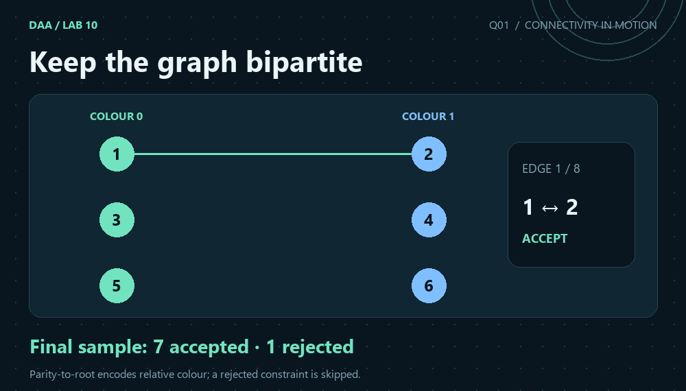
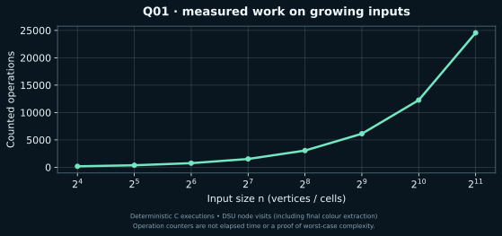

[← Lab 10](../README.md) · [Repository](../../README.md) · [Next](../Q-2/README.md)

# Q01 · Online Graph-Bipartiteness Testing



**Keep the graph bipartite** · C17 · union by size · path compression · independent graph replay

## Problem

Edges of an undirected graph arrive one by one. Accept an edge if it preserves bipartiteness; otherwise report an odd-cycle violation and skip that edge.

## Input contract

`V E`, followed by E rows `u v`. Vertices are numbered 1..V. V = 1..200000 and E = 0..200000. Self-loops are rejected; repeated consistent edges are accepted arrivals. Rejected edges never enter the maintained graph.

Malformed or trailing input is rejected with a message on standard error and a nonzero status. [All input formats](../INPUTS.md).

## Algorithm

Store a parent, component size and XOR parity from each vertex to its parent. Path compression accumulates parity to the root. Vertices in different components can always be joined, setting the root-to-root parity to parity(u) XOR parity(v) XOR 1. If they already share a root, accept exactly when their parities differ. Finally extract a valid two-colouring of all accepted edges.

## Correctness

The invariant is that the XOR path to a root represents a valid relative colour assignment in that component. An edge requires colour(u) XOR colour(v)=1. Different components have independent colour flips, so the required root relation can always be imposed. Within one component the relation is already fixed: equal parity creates an odd closed walk and hence an odd cycle; opposite parity is consistent. A rejected edge changes no graph connectivity or parity constraint.

## Complexity

Union by size with path compression costs amortised inverse-Ackermann time per operation. Initialisation and final colour extraction are linear, giving O(V + E*alpha(V)) amortised time and O(V) space. The counter records DSU node visits, including final colour extraction.

`alpha` denotes the inverse Ackermann function. The DSU bound is amortised over the sequence; an individual find is not claimed to have constant worst-case cost. The formulas use `log(V+1)` or `log(n+1)` for singleton conventions.

## Compile and run

From the repository root on Linux/macOS with GCC or Clang:

```sh
python3 lab10/tools/build.py
lab10/bin/q1_online_bipartiteness < lab10/Q-1/q1_sample_input.txt
```

For a single solution, preserve `lab10/common/` beside the question directories:

```sh
gcc -std=c17 -O2 -Wall -Wextra -Wpedantic -Werror lab10/Q-1/q1_online_bipartiteness.c -o q1
./q1 < lab10/Q-1/q1_sample_input.txt
```

On Windows PowerShell with GCC on PATH:

```powershell
py lab10/tools/build.py
Get-Content lab10/Q-1/q1_sample_input.txt | & .\lab10\bin\q1_online_bipartiteness.exe
```

The C entry point is `int main(void)` and prints ordinary readable results. Python scripts parse these results for validation and generate the JSON evidence files used by the graphics.

## Actual sample

```text
6 8
1 2
2 3
3 1
3 4
4 1
5 6
2 5
4 5
```

Output from the compiled C program:

```text
Edge 1 (1,2): ACCEPTED
Edge 2 (2,3): ACCEPTED
Edge 3 (3,1): REJECTED (odd cycle)
Edge 4 (3,4): ACCEPTED
Edge 5 (4,1): ACCEPTED
Edge 6 (5,6): ACCEPTED
Edge 7 (2,5): ACCEPTED
Edge 8 (4,5): ACCEPTED
Accepted arrivals: 7 of 8
Final colours: 0 1 0 1 0 1
Work: 48
```

The sample rejects edge (3,1), which closes a triangle, and accepts the other seven arrivals. Final colours 0 1 0 1 0 1 satisfy every retained edge.

[Input](q1_sample_input.txt) · [Captured stdout](q1_sample_output.txt) · [Parsed evidence](q1_sample_trace.json)

## Measured evidence



Counted event: **DSU node visits (including final colour extraction)**. [Measured dataset](q1_data.dat) · [Full scaling inputs, results and oracle status](../scaling_evidence.json).

The graph is one deterministic input family, not a worst-case proof. Initialisation, input/output and arithmetic not explicitly instrumented are excluded from this event counter. The theoretical bound above covers the complete algorithm. The animated graph/grid states are reconstructed from the saved sample and replayed connectivity, using the C program's reported answers.

## Verification and conclusion

The sample rejects edge (3,1), which closes a triangle, and accepts the other seven arrivals. Final colours 0 1 0 1 0 1 satisfy every retained edge.

The lab passed 526 core executions and 40 scaling executions. Independent checks use graph BFS, flood fill, forward deletion replay and exhaustive reachable swap states, rather than a second DSU implementation. [Verification details](../VERIFICATION.md).
