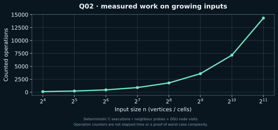

[← Lab 10](../README.md) · [Repository](../../README.md) · [Previous](../Q-1/README.md) · [Next](../Q-3/README.md)

# Q02 · Dynamic Connected Components in a Grid


**Watch the islands merge** · C17 · union by size · path compression · independent graph replay

## Problem

An initially water-filled R by C grid receives land additions. After every operation, return the number of four-directionally connected land components.

## Input contract

`R C k`, followed by k rows `r c`. Grid coordinates are zero based: 0 <= r < R and 0 <= c < C. R and C are positive, R*C <= 1000000, and k = 0..200000. Repeated additions are harmless duplicates.

Malformed or trailing input is rejected with a message on standard error and a nonzero status. [All input formats](../INPUTS.md).

## Algorithm

Flatten cell (r,c) to r*C+c and keep a separate active-land flag. A new land cell starts one island. Attempt to join it to each active orthogonal neighbour; decrease the count only when two different DSU roots actually merge. Ignore repeated additions. The DSU arrays are initialised densely, so grid initialisation is part of the bound.

## Correctness

Before an addition, DSU sets of active cells equal the current islands. A new active cell creates one singleton. Each successful neighbour union reduces the number of sets by one, while an already-connected neighbour does not. These are exactly the possible new four-directional connections, so the updated counter equals the number of islands. Ignoring duplicates preserves this invariant.

## Complexity

Dense initialisation costs O(R*C). Each of k additions attempts at most four neighbour joins, giving O(R*C + k*alpha(R*C)) amortised time and O(R*C) space. The plotted counter includes neighbour probes and DSU visits but excludes dense initialisation and input/output work.

`alpha` denotes the inverse Ackermann function. The DSU bound is amortised over the sequence; an individual find is not claimed to have constant worst-case cost. The formulas use `log(V+1)` or `log(n+1)` for singleton conventions.

## Compile and run

From the repository root on Linux/macOS with GCC or Clang:

```sh
python3 lab10/tools/build.py
lab10/bin/q2_dynamic_grid_components < lab10/Q-2/q2_sample_input.txt
```

For a single solution, preserve `lab10/common/` beside the question directories:

```sh
gcc -std=c17 -O2 -Wall -Wextra -Wpedantic -Werror lab10/Q-2/q2_dynamic_grid_components.c -o q2
./q2 < lab10/Q-2/q2_sample_input.txt
```

On Windows PowerShell with GCC on PATH:

```powershell
py lab10/tools/build.py
Get-Content lab10/Q-2/q2_sample_input.txt | & .\lab10\bin\q2_dynamic_grid_components.exe
```

The C entry point is `int main(void)` and prints ordinary readable results. Python scripts parse these results for validation and generate the JSON evidence files used by the graphics.

## Actual sample

```text
3 4 8
0 0
0 1
1 2
2 1
1 1
1 1
2 3
2 2
```

Output from the compiled C program:

```text
Add 1 (0,0): islands=1
Add 2 (0,1): islands=1
Add 3 (1,2): islands=2
Add 4 (2,1): islands=3
Add 5 (1,1): islands=1
Add 6 (1,1): islands=1 (duplicate)
Add 7 (2,3): islands=2
Add 8 (2,2): islands=1
Work: 48
```

The sample island counts are 1,1,2,3,1,1,2,1. The repeated addition at (1,1) keeps the count unchanged, and only successful unions reduce it.

[Input](q2_sample_input.txt) · [Captured stdout](q2_sample_output.txt) · [Parsed evidence](q2_sample_trace.json)

## Measured evidence



Counted event: **neighbour probes + DSU node visits**. [Measured dataset](q2_data.dat) · [Full scaling inputs, results and oracle status](../scaling_evidence.json).

The graph is one deterministic input family, not a worst-case proof. Initialisation, input/output and arithmetic not explicitly instrumented are excluded from this event counter. The theoretical bound above covers the complete algorithm. The animated graph/grid states are reconstructed from the saved sample and replayed connectivity, using the C program's reported answers.

## Verification and conclusion

The sample island counts are 1,1,2,3,1,1,2,1. The repeated addition at (1,1) keeps the count unchanged, and only successful unions reduce it.

The lab passed 526 core executions and 40 scaling executions. Independent checks use graph BFS, flood fill, forward deletion replay and exhaustive reachable swap states, rather than a second DSU implementation. [Verification details](../VERIFICATION.md).
