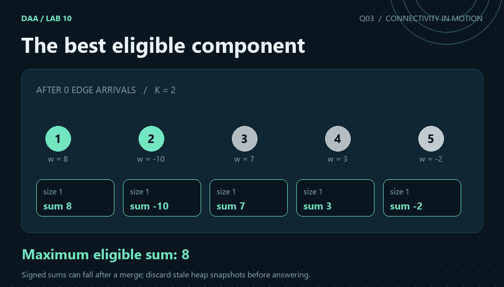
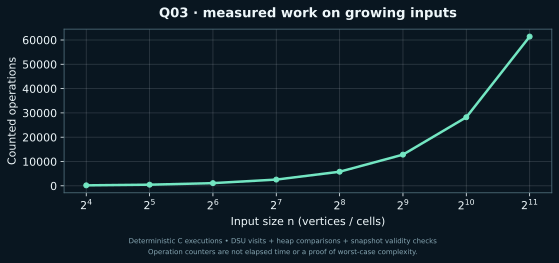

[← Lab 10](../README.md) · [Repository](../../README.md) · [Previous](../Q-2/README.md) · [Next](../Q-4/README.md)

# Q03 · Maximum Weight Component with Size Constraints



**The best eligible component** · C17 · union by size · path compression · independent graph replay

## Problem

A vertex-weighted graph receives weighted edges sequentially. Initially and after every arrival, find the greatest total vertex weight among connected components containing at most K vertices.

## Input contract

`V E K`, then V signed vertex weights, then E rows `u v edge_weight`. V = 1..200000, E = 0..200000 and K = 0..V. Vertex IDs are 1..V; vertex and edge weights are -10^9..10^9. Step 0 reports the initial isolated-vertex state. `NONE` means no nonempty component meets the size limit.

Malformed or trailing input is rejected with a message on standard error and a nonzero status. [All input formats](../INPUTS.md).

## Algorithm

Maintain component size and signed vertex-weight sum at DSU roots. Keep a max-heap of snapshots for eligible roots. After a successful union, insert its new snapshot only if its size is at most K. Before answering, discard snapshots whose ID is no longer a root, whose sum has changed, or whose size exceeds K. Edge weights are retained in the input as labels: the question defines connectivity by arrival and the objective by vertex weights, without specifying any edge-weight filtering or priority.

## Correctness

The live DSU roots partition the current graph, and each root stores its exact size and vertex sum. Every eligible component has a matching current snapshot: initial singletons are inserted and each successful eligible merge is inserted. Invalid snapshots may remain below the heap top, but removing invalid top entries until one is live leaves a greatest eligible sum. Components only grow, so an oversized component cannot become eligible later. Snapshot validation is essential when signed sums decrease.

## Complexity

At most V-1 successful unions occur. There are at most 2V-1 heap insertions and removals across all queries, each O(log V), while all E union attempts cost O(E*alpha(V)) amortised. Total time is O(V + E*alpha(V) + V*log V), with O(V) space. Edge weights are not sorted or added to component totals.

`alpha` denotes the inverse Ackermann function. The DSU bound is amortised over the sequence; an individual find is not claimed to have constant worst-case cost. The formulas use `log(V+1)` or `log(n+1)` for singleton conventions.

## Compile and run

From the repository root on Linux/macOS with GCC or Clang:

```sh
python3 lab10/tools/build.py
lab10/bin/q3_maximum_weight_component < lab10/Q-3/q3_sample_input.txt
```

For a single solution, preserve `lab10/common/` beside the question directories:

```sh
gcc -std=c17 -O2 -Wall -Wextra -Wpedantic -Werror lab10/Q-3/q3_maximum_weight_component.c -o q3
./q3 < lab10/Q-3/q3_sample_input.txt
```

On Windows PowerShell with GCC on PATH:

```powershell
py lab10/tools/build.py
Get-Content lab10/Q-3/q3_sample_input.txt | & .\lab10\bin\q3_maximum_weight_component.exe
```

The C entry point is `int main(void)` and prints ordinary readable results. Python scripts parse these results for validation and generate the JSON evidence files used by the graphics.

## Actual sample

```text
5 5 2
8 -10 7 3 -2
1 2 4
3 4 1
1 3 9
4 5 -1
2 5 2
```

Output from the compiled C program:

```text
Step 0: maximum=8
Step 1: maximum=7
Step 2: maximum=10
Step 3: maximum=-2
Step 4: maximum=NONE
Step 5: maximum=NONE
Work: 43
```

With K=2, the sample maxima are 8,7,10,-2,NONE,NONE. The negative answer -2 is valid; later no component satisfies the size limit.

[Input](q3_sample_input.txt) · [Captured stdout](q3_sample_output.txt) · [Parsed evidence](q3_sample_trace.json)

## Measured evidence



Counted event: **DSU visits + heap comparisons + snapshot validity checks**. [Measured dataset](q3_data.dat) · [Full scaling inputs, results and oracle status](../scaling_evidence.json).

The graph is one deterministic input family, not a worst-case proof. Initialisation, input/output and arithmetic not explicitly instrumented are excluded from this event counter. The theoretical bound above covers the complete algorithm. The animated graph/grid states are reconstructed from the saved sample and replayed connectivity, using the C program's reported answers.

## Verification and conclusion

With K=2, the sample maxima are 8,7,10,-2,NONE,NONE. The negative answer -2 is valid; later no component satisfies the size limit.

The lab passed 526 core executions and 40 scaling executions. Independent checks use graph BFS, flood fill, forward deletion replay and exhaustive reachable swap states, rather than a second DSU implementation. [Verification details](../VERIFICATION.md).
