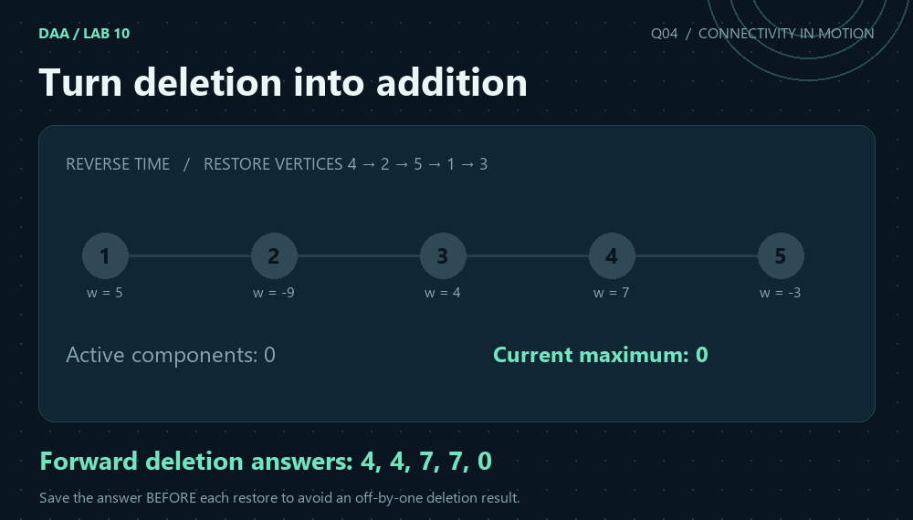
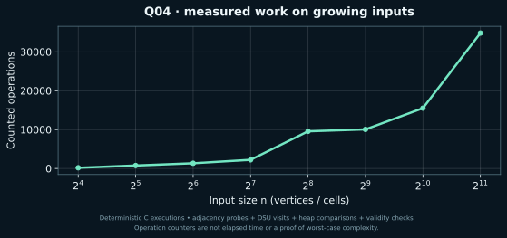

[← Lab 10](../README.md) · [Repository](../../README.md) · [Previous](../Q-3/README.md) · [Next](../Q-5/README.md)

# Q04 · Reverse Time-Step DSU Application



**Turn deletion into addition** · C17 · union by size · path compression · independent graph replay

## Problem

Delete every vertex of a vertex-weighted undirected graph in a supplied order. After each deletion, find the maximum vertex-weight sum among the remaining connected components.

## Input contract

`V E`, then V signed vertex weights, E rows `u v`, and finally a permutation of all V vertex IDs giving deletion order. V = 1..200000, E = 0..200000, IDs = 1..V and vertex weights = -10^9..10^9. The empty graph is reported as 0; a nonempty graph can have a negative maximum.

Malformed or trailing input is rejected with a message on standard error and a nonzero status. [All input formats](../INPUTS.md).

## Algorithm

Read the graph into adjacency lists and process the deletion permutation backwards as activations. Immediately before restoring P[i], the active graph is exactly the state after the corresponding forward deletion, so save its answer then. Activate that vertex, join it to already active neighbours, and update a lazy component-sum max-heap. This supports negative weights, for which a simple running maximum would be incorrect.

## Correctness

After removing P[0] through P[i], the surviving vertices are P[i+1] through P[V-1]. These are exactly the active vertices just before the reverse loop restores P[i]. Every surviving edge appears once both endpoints are active, and DSU unions exactly the surviving connected components. Reading the heap at that moment therefore yields the required forward answer. The empty graph receives the declared value zero; nonempty negative maxima are preserved.

## Complexity

Adjacency construction and scans take O(V+E). DSU operations cost O((V+E)*alpha(V)) amortised. At most 2V-1 snapshots are inserted, giving O(V*log V) heap work overall. Total time is O((V+E)*alpha(V) + V*log V) and space O(V+E). The logarithmic term is needed for signed-weight maxima.

`alpha` denotes the inverse Ackermann function. The DSU bound is amortised over the sequence; an individual find is not claimed to have constant worst-case cost. The formulas use `log(V+1)` or `log(n+1)` for singleton conventions.

## Compile and run

From the repository root on Linux/macOS with GCC or Clang:

```sh
python3 lab10/tools/build.py
lab10/bin/q4_reverse_time_dsu < lab10/Q-4/q4_sample_input.txt
```

For a single solution, preserve `lab10/common/` beside the question directories:

```sh
gcc -std=c17 -O2 -Wall -Wextra -Wpedantic -Werror lab10/Q-4/q4_reverse_time_dsu.c -o q4
./q4 < lab10/Q-4/q4_sample_input.txt
```

On Windows PowerShell with GCC on PATH:

```powershell
py lab10/tools/build.py
Get-Content lab10/Q-4/q4_sample_input.txt | & .\lab10\bin\q4_reverse_time_dsu.exe
```

The C entry point is `int main(void)` and prints ordinary readable results. Python scripts parse these results for validation and generate the JSON evidence files used by the graphics.

## Actual sample

```text
5 4
5 -9 4 7 -3
1 2
2 3
3 4
4 5
3 1 5 2 4
```

Output from the compiled C program:

```text
Delete 1 (vertex 3): maximum=4
Delete 2 (vertex 1): maximum=4
Delete 3 (vertex 5): maximum=7
Delete 4 (vertex 2): maximum=7
Delete 5 (vertex 4): maximum=0 (empty graph)
Work: 42
```

In forward deletion order 3,1,5,2,4, the sample answers are 4,4,7,7,0. The final zero denotes an empty graph. Independent deletion-and-BFS replay checks every saved answer.

[Input](q4_sample_input.txt) · [Captured stdout](q4_sample_output.txt) · [Parsed evidence](q4_sample_trace.json)

## Measured evidence



Counted event: **adjacency probes + DSU visits + heap comparisons + validity checks**. [Measured dataset](q4_data.dat) · [Full scaling inputs, results and oracle status](../scaling_evidence.json).

The graph is one deterministic input family, not a worst-case proof. Initialisation, input/output and arithmetic not explicitly instrumented are excluded from this event counter. The theoretical bound above covers the complete algorithm. The animated graph/grid states are reconstructed from the saved sample and replayed connectivity, using the C program's reported answers.

## Verification and conclusion

In forward deletion order 3,1,5,2,4, the sample answers are 4,4,7,7,0. The final zero denotes an empty graph. Independent deletion-and-BFS replay checks every saved answer.

The lab passed 526 core executions and 40 scaling executions. Independent checks use graph BFS, flood fill, forward deletion replay and exhaustive reachable swap states, rather than a second DSU implementation. [Verification details](../VERIFICATION.md).
