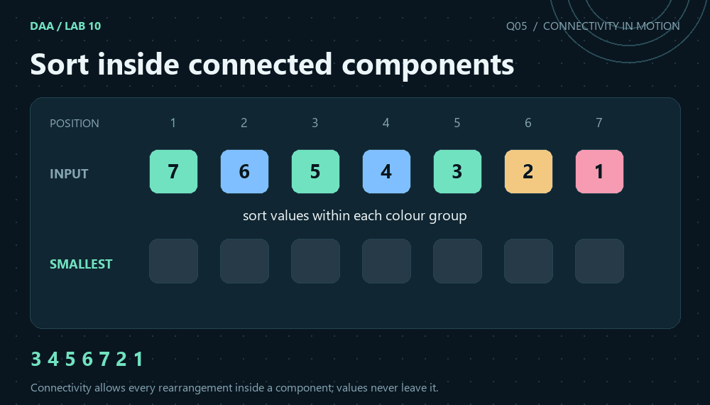
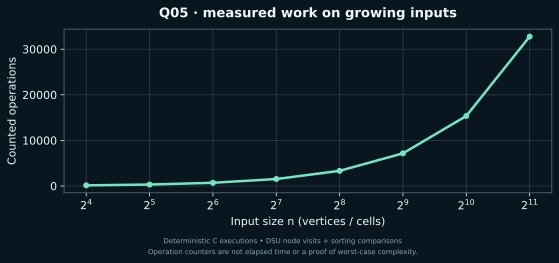

[← Lab 10](../README.md) · [Repository](../../README.md) · [Previous](../Q-4/README.md)

# Q05 · Lexicographically Smallest Connected Component Permutation



**Sort inside connected components** · C17 · union by size · path compression · independent graph replay

## Problem

Given a permutation and graph edges specifying allowable swaps of positions, find the lexicographically smallest permutation reachable through any number of those swaps.

## Input contract

`n m`, then a permutation of 1..n, followed by m rows `u v` of allowed position swaps. n = 1..200000, m = 0..200000 and position IDs are 1..n. Duplicate edges and self-loops are harmless.

Malformed or trailing input is rejected with a message on standard error and a nonzero status. [All input formats](../INPUTS.md).

## Algorithm

Use DSU to discover the connected sets of positions. Create records containing root, position and value. Stable merge sort orders one copy by (root, position) and another by (root, value). Pair corresponding records and place each group's ascending values into its ascending positions. Isolated positions remain fixed.

## Correctness

An edge swap cannot move a value outside its connected component. Conversely, swaps along a path generate transpositions between any two positions in that component, so every rearrangement of its values is reachable. At the earliest position where two attainable permutations differ, assigning the smallest remaining value available in that position's component is best. Repeating that choice is exactly sorting each component's values into its increasing positions.

## Complexity

DSU discovery costs O((n+m)*alpha(n)) amortised. Two deterministic merge sorts cost O(n*log n), and the final assignment is linear. Time is O((n+m)*alpha(n) + n*log n), with O(n) auxiliary space. The implementation uses its own merge sort, so the sorting bound does not depend on the C library's qsort.

`alpha` denotes the inverse Ackermann function. The DSU bound is amortised over the sequence; an individual find is not claimed to have constant worst-case cost. The formulas use `log(V+1)` or `log(n+1)` for singleton conventions.

## Compile and run

From the repository root on Linux/macOS with GCC or Clang:

```sh
python3 lab10/tools/build.py
lab10/bin/q5_smallest_component_permutation < lab10/Q-5/q5_sample_input.txt
```

For a single solution, preserve `lab10/common/` beside the question directories:

```sh
gcc -std=c17 -O2 -Wall -Wextra -Wpedantic -Werror lab10/Q-5/q5_smallest_component_permutation.c -o q5
./q5 < lab10/Q-5/q5_sample_input.txt
```

On Windows PowerShell with GCC on PATH:

```powershell
py lab10/tools/build.py
Get-Content lab10/Q-5/q5_sample_input.txt | & .\lab10\bin\q5_smallest_component_permutation.exe
```

The C entry point is `int main(void)` and prints ordinary readable results. Python scripts parse these results for validation and generate the JSON evidence files used by the graphics.

## Actual sample

```text
7 3
7 6 5 4 3 2 1
1 3
3 5
2 4
```

Output from the compiled C program:

```text
Smallest permutation: 3 4 5 6 7 2 1
Work: 39
```

The sample result is 3 4 5 6 7 2 1. Positions 1,3,5 share one component, positions 2,4 share another, and positions 6 and 7 stay fixed.

[Input](q5_sample_input.txt) · [Captured stdout](q5_sample_output.txt) · [Parsed evidence](q5_sample_trace.json)

## Measured evidence



Counted event: **DSU node visits + sorting comparisons**. [Measured dataset](q5_data.dat) · [Full scaling inputs, results and oracle status](../scaling_evidence.json).

The graph is one deterministic input family, not a worst-case proof. Initialisation, input/output and arithmetic not explicitly instrumented are excluded from this event counter. The theoretical bound above covers the complete algorithm. The animated graph/grid states are reconstructed from the saved sample and replayed connectivity, using the C program's reported answers.

## Verification and conclusion

The sample result is 3 4 5 6 7 2 1. Positions 1,3,5 share one component, positions 2,4 share another, and positions 6 and 7 stay fixed.

The lab passed 526 core executions and 40 scaling executions. Independent checks use graph BFS, flood fill, forward deletion replay and exhaustive reachable swap states, rather than a second DSU implementation. [Verification details](../VERIFICATION.md).
