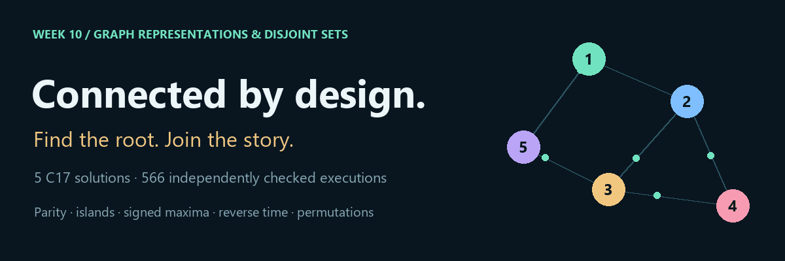
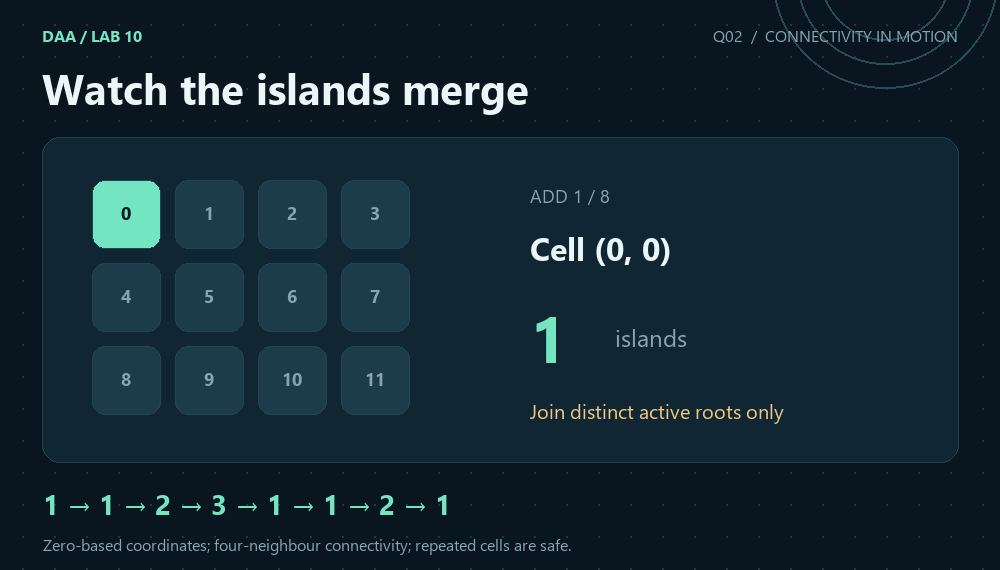
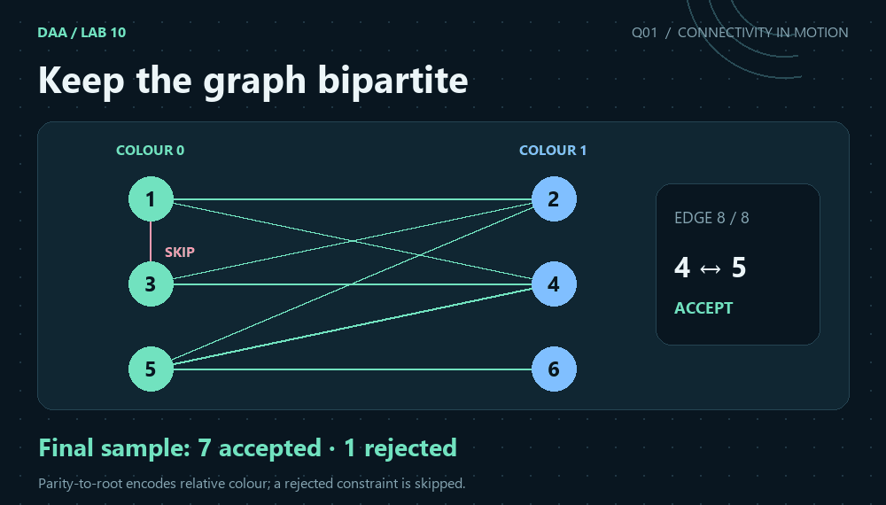

[← Repository](../README.md) · [Lab 07](../lab7/lab7/README.md) · [Lab 08](../lab8/README.md) · [Lab 09](../lab9/README.md)



# Lab 10 · Graphs and disjoint sets

**13 October 2026 · Dr. Ajaya Kumar Dash · BTech CS-B / CE · Semester 3**

Five graph problems explore what a connected component remembers: relative colour, island membership, vertex-weight sum, history under deletion, and the values allowed to move together. Each page links the C solution, its proof, actual output, measured work and an original animation.

  

## Question map

| Q | Exact question-paper title | Bound |
|:--:|---|---|
| [01](Q-1/README.md) | Online Graph-Bipartiteness Testing | O(V + E alpha(V)) amortised time; O(V) space |
| [02](Q-2/README.md) | Dynamic Connected Components in a Grid | O(RC + k alpha(RC)) amortised time; O(RC) space |
| [03](Q-3/README.md) | Maximum Weight Component with Size Constraints | O(V + E alpha(V) + V log V) amortised time; O(V) space |
| [04](Q-4/README.md) | Reverse Time-Step DSU Application | O((V+E) alpha(V) + V log V) amortised time; O(V+E) space |
| [05](Q-5/README.md) | Lexicographically Smallest Connected Component Permutation | O((V+E) alpha(V) + V log V) time; O(V) space |

All DSU bounds are amortised. The max-heap in Q3 and Q4 supports **signed vertex weights**, so a decrease in component sum cannot leave a false running maximum. Q3 accepts the paper's edge weights as labels and processes edges in their supplied arrival order; no edge-weight threshold is specified in the paper. Q4 records each result **before** its reverse restoration.

## Five visual explanations

<table>
<tr><td width="50%"><a href="Q-1/README.md"></a><p><strong>Q01 · Keep the graph bipartite</strong></p></td><td width="50%"><a href="Q-2/README.md"></a><p><strong>Q02 · Watch the islands merge</strong></p></td></tr><tr><td width="50%"><a href="Q-3/README.md"></a><p><strong>Q03 · The best eligible component</strong></p></td><td width="50%"><a href="Q-4/README.md"></a><p><strong>Q04 · Turn deletion into addition</strong></p></td></tr><tr><td colspan="2" align="center"><a href="Q-5/README.md"></a><p><strong>Q05 · Sort inside connected components</strong></p></td></tr>
</table>

## Reproduce

From the repository root with Python 3 and GCC/Clang:

```sh
python3 lab10/tools/build.py
python3 lab10/tools/validate.py
python3 lab10/tools/generate_evidence.py
```

On Windows, replace `python3` with `py`, or run `lab10/build_windows.bat`. The solutions and checkers use no third-party Python package. Set `CC=clang` to select Clang on Linux.

To regenerate the artwork, install `lab10/requirements-art.txt` and run `python3 lab10/tools/generate_visuals.py`. The C programs use simple `main(void)` functions and readable standard output. The Python layer creates machine-readable traces from those results.

## Input, evidence and source

[Official question paper](Problem-Sheet-Lab-10.pdf) · [Input guide](INPUTS.md) · [Verification](VERIFICATION.md) · [Core results](verification.json) · [Complete scaling evidence](scaling_evidence.json)

There are **526 core runs + 40 scaling runs = 566 independently checked executions**. Saved operation counters represent real C work events, rather than elapsed time. Correctness is checked by graph traversal and exhaustive small-state exploration.


