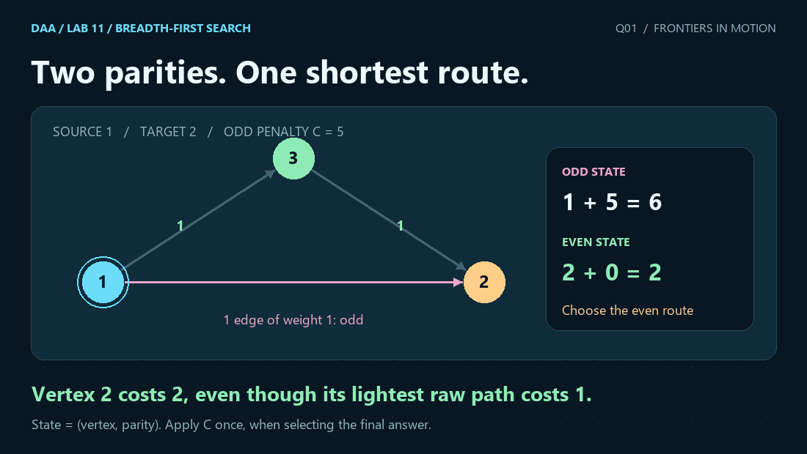
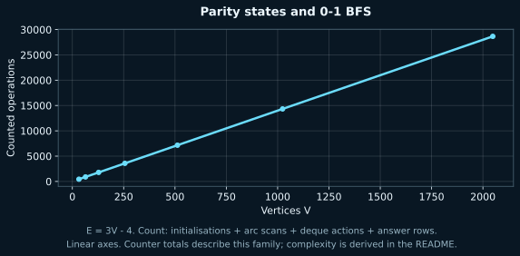

<p align="center"></p>

# 1. Shortest Path on Parity-Constrained Graphs via 0-1 BFS

[← Lab dashboard](../README.md) · [All Lab 11 questions](../README.md) · [Q2 →](../Q-2/README.md)

 

## Problem

Find each minimum source-to-vertex cost in a directed 0/1 graph, adding C once when the number of weight-1 edges is odd.

## Representation and algorithm

Replace each vertex by even and odd parity states. A weight-1 edge flips parity; a weight-0 edge preserves it. Run 0-1 BFS, then choose min(d_even, d_odd+C).

## Why it works

Each original route maps to a route in the two-layer state graph with the same raw weight and the correct ending parity, and conversely. The 0/1 deque processes minimum-distance entries first; stale entries are skipped and each state is settled once. The only remaining decision is which final parity minimises the effective cost. C belongs in the final comparison, not on every weight-1 edge.

## Complexity

The expanded graph has 2V states and 2E implicit arcs. Each settled state scans its arcs once; each successful relaxation creates one deque entry. Total time is O(V+E), including initialisation and output, with O(V+E) space. At most 2E+1 entries are ever pushed, so a circular deque of capacity 2E+2 is sufficient.

## Input and output

```text
V E S C
u1 v1 w1
... E directed edges ...
```
Vertices are 1-based. `1 <= V <= 200000`, `0 <= E <= 400000`, `1 <= S <= V`, `0 <= C <= 10^12`, and every edge weight is 0 or 1. Parallel edges and self-loops are allowed. Output gives the shortest raw distance for each parity and the minimum effective cost. `INF` marks a missing parity; `UNREACHABLE` means both are missing. Routes may revisit an original vertex in a different parity state.

### Sample input

```text
6 6 1 5
1 2 1
1 3 1
3 2 1
2 4 0
3 5 0
5 4 1
```

### Actual C output

```text
Vertex  Even  Odd  Minimum effective cost
1  0  INF  0
2  2  1  2
3  INF  1  6
4  2  1  2
5  INF  1  6
6  INF  INF  UNREACHABLE
Work: 45
```

For vertex 2, an odd route of raw weight 1 costs 6, while the even route 1 -> 3 -> 2 costs 2. Vertex 6 is unreachable.

## Measured evidence



V=32..2048, doubling; E=3V-4. The connected directed family combines an alternating-weight forward chain, weight-1 forward shortcuts and weight-0 backward links. C=5. Both parity states participate. An independent Bellman-Ford implementation checks every output row.

The counted events are **vertex/state initialisations + arc scans + deque actions + answer rows**. Counters exclude parsing, allocation internals and printing characters; they count the named events, not CPU instructions or elapsed time. Both plot axes are linear. The asymptotic bound comes from the argument above; a finite plot cannot prove a worst-case bound. Q3's constant-time hash-lookup claim is an expectation, not a guaranteed bound for every possible dictionary.

The [raw dataset](q1_data.dat) comes from actual compiled C runs. [Scaling evidence](../scaling_evidence.json) records inputs, parameter values, stdout and oracle results. [Verification](../VERIFICATION.md) explains the independent checks.

## Run this solution

From the repository root:

```sh
gcc -std=c17 -O2 -Wall -Wextra -Wpedantic -Werror lab11/Q-1/q1_parity_shortest_paths.c -o q1
./q1 < lab11/Q-1/q1_sample_input.txt
```

On Windows use `q1.exe` in place of `./q1`. The source includes the shared header from `../common/`; keep that relative directory when uploading.

## Files

| File | Purpose |
|---|---|
| [C solution](q1_parity_shortest_paths.c) | Complete stdin/stdout program |
| [Input](q1_sample_input.txt) · [Output](q1_sample_output.txt) | Reproducible sample |
| [Dataset](q1_data.dat) · [SVG](q1_graph.svg) · [PNG](q1_graph.png) | Measured graph and report image |
| [Animation](q1_animation.gif) · [Still](q1_overview.png) | Visual explanation |
