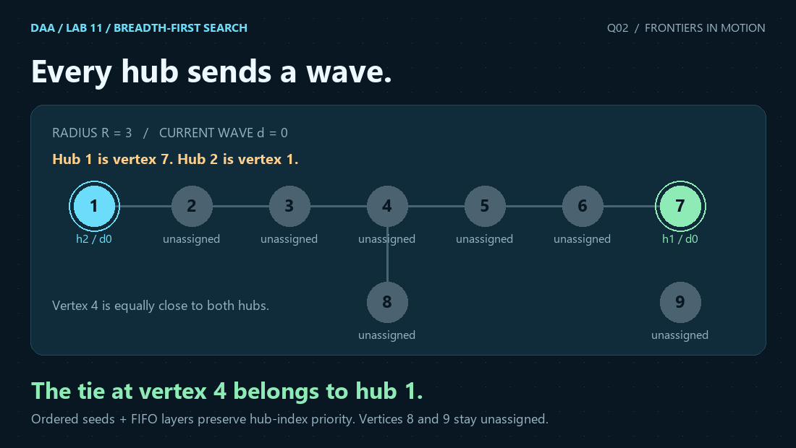
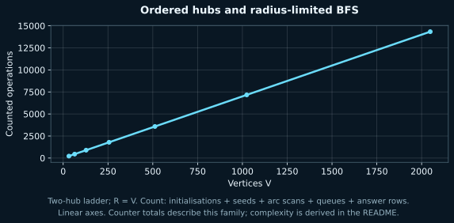

<p align="center"></p>

# 2. Multi-Source BFS for Radius-Constrained Voronoi Cell Partitioning

[← Q1](../Q-1/README.md) · [All Lab 11 questions](../README.md) · [Q3 →](../Q-3/README.md)

 

## Problem

Assign each vertex within radius R to its nearest hub, breaking equal-distance ties by hub index; report its distance or -1.

## Representation and algorithm

Seed one FIFO queue with distinct hubs in increasing hub-index order. First discovery fixes distance and owner. Stop expanding vertices at distance R.

## Why it works

FIFO BFS visits vertices in nondecreasing distance. Within each distance layer, processing order is nondecreasing owner index: it holds for the ordered seed layer, and each layer appends the next layer in that same owner order. Therefore the first shortest discovery has the smallest eligible hub index. Pruning at R cannot affect any vertex at distance at most R.

## Complexity

Building adjacency lists takes O(V+E). Each covered vertex is queued once, each expanded adjacency entry is scanned once, and all V output rows are written. Time is O(V+E+K), which is O(V+E) for distinct hubs; space is O(V+E). Unassigned vertices print owner=-1 and distance=-1.

## Input and output

```text
V E K R
h1 h2 ... hK
u1 v1
... E undirected edges ...
```
Vertices are 1-based. `1 <= V <= 200000`, `0 <= E <= 400000`, `0 <= K <= V`, `0 <= R <= 200000`. Hubs must be distinct and their **input order defines their indices**. A smaller vertex number has no priority. The empty hub set is supported; its hub line may be omitted. Output rows contain vertex, owner index and distance. An unassigned vertex has `-1 -1`; no distance to an arbitrary hub is reported. Self-loops and parallel edges are allowed.

### Sample input

```text
9 7 2 3
7 1
1 2
2 3
3 4
4 5
5 6
6 7
4 8
```

### Actual C output

```text
Vertex  Owner  Distance
1  2  0
2  2  1
3  2  2
4  1  3
5  1  2
6  1  1
7  1  0
8  -1  -1
9  -1  -1
Work: 44
```

Vertex 4 is three edges from both hubs. It belongs to hub 1 at vertex 7. Vertex 8 exceeds radius 3, while vertex 9 is disconnected; both remain unassigned.

## Measured evidence



V=32..2048, doubling; an undirected two-row ladder has E=3V/2-2, hubs [V,1], and R=V. Independent single-source BFS from each hub computes the minimum (distance,index) pair for every vertex.

The counted events are **vertex initialisations + hub seeds + arc scans + queue actions + answer rows**. Counters exclude parsing, allocation internals and printing characters; they count the named events, not CPU instructions or elapsed time. Both plot axes are linear. The asymptotic bound comes from the argument above; a finite plot cannot prove a worst-case bound. Q3's constant-time hash-lookup claim is an expectation, not a guaranteed bound for every possible dictionary.

The [raw dataset](q2_data.dat) comes from actual compiled C runs. [Scaling evidence](../scaling_evidence.json) records inputs, parameter values, stdout and oracle results. [Verification](../VERIFICATION.md) explains the independent checks.

## Run this solution

From the repository root:

```sh
gcc -std=c17 -O2 -Wall -Wextra -Wpedantic -Werror lab11/Q-2/q2_radius_voronoi.c -o q2
./q2 < lab11/Q-2/q2_sample_input.txt
```

On Windows use `q2.exe` in place of `./q2`. The source includes the shared header from `../common/`; keep that relative directory when uploading.

## Files

| File | Purpose |
|---|---|
| [C solution](q2_radius_voronoi.c) | Complete stdin/stdout program |
| [Input](q2_sample_input.txt) · [Output](q2_sample_output.txt) | Reproducible sample |
| [Dataset](q2_data.dat) · [SVG](q2_graph.svg) · [PNG](q2_graph.png) | Measured graph and report image |
| [Animation](q2_animation.gif) · [Still](q2_overview.png) | Visual explanation |
