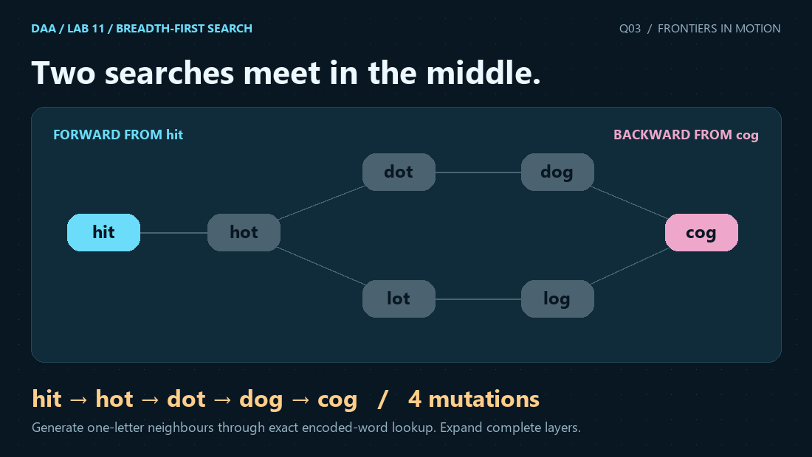
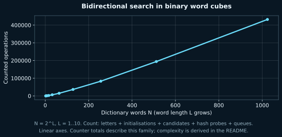

<p align="center"></p>

# 3. Bidirectional BFS for Shortest Transformation Sequence in a Word Graph

[← Q2](../Q-2/README.md) · [All Lab 11 questions](../README.md) · [Repository →](../../README.md)

 

## Problem

Find the fewest one-letter dictionary mutations from A to B and print a shortest sequence, with N up to 100000 and L up to 10.

## Representation and algorithm

Encode words exactly in base 26 and find neighbours through an open-addressed table. Expand a complete layer of the smaller BFS frontier; reconstruct through the best meeting.

## Why it works

Base-26 encoding is injective for a fixed length, and replacing one digit generates exactly the 25L possible one-letter changes. Both searches have complete distance layers. Before their first meeting, their visited balls of depths a and b are disjoint, implying the shortest distance exceeds a+b. Expanding one complete next layer finds the minimum crossing; a shorter route would have intersected the earlier balls. Parent chains on both sides therefore recover a shortest valid sequence.

## Complexity

Building encodings takes O(NL). At most N+1 words are visited from each side, with 25L constant-time digit replacements per expanded word. With expected constant-time hash lookup, time is O(NL+26NL), or O(NL) for the fixed alphabet; space is O(N+L). Adversarial hash collisions can give O(N^2 L) worst-case time. Bidirectional search reduces explored vertices on many inputs but retains the same worst-case search order.

## Input and output

```text
N L
A B
word1
... N unique dictionary words ...
```
`1 <= N <= 100000`, `1 <= L <= 10`; all words use exactly L lowercase English letters. A may be absent from D. B must be in D: even A=B returns -1 when B is missing, following the paper's explicit target-membership condition. Output is the minimum number of mutations (edges, not words), one shortest sequence, and a measured work counter. No possible sequence prints `Sequence: NONE`. Duplicate dictionary entries are rejected.

### Sample input

```text
6 3
hit cog
hot
dot
dog
lot
log
cog
```

### Actual C output

```text
Minimum mutations: 4
Sequence: hit -> hot -> dot -> dog -> cog
Work: 895
```

The sample requires four mutations: hit -> hot -> dot -> dog -> cog. A may start outside the dictionary; B must be present, including the A=B case.

## Measured evidence



N=2..1024, doubling; D is the complete binary word cube of length L=log2(N), embedded in the lowercase alphabet. A is all a, B all b, and the exact shortest distance is L. This is a connected, nonzero-distance family. N and L both change, so the curve describes this family, rather than varying N at a fixed L. The main validator separately tests N=100000 and L=10.

The counted events are **encoded letters + distance initialisations + mutation candidates + hash probes + queue actions**. Counters exclude parsing, allocation internals and printing characters; they count the named events, not CPU instructions or elapsed time. Both plot axes are linear. The asymptotic bound comes from the argument above; a finite plot cannot prove a worst-case bound. Q3's constant-time hash-lookup claim is an expectation, not a guaranteed bound for every possible dictionary.

The [raw dataset](q3_data.dat) comes from actual compiled C runs. [Scaling evidence](../scaling_evidence.json) records inputs, parameter values, stdout and oracle results. [Verification](../VERIFICATION.md) explains the independent checks.

## Run this solution

From the repository root:

```sh
gcc -std=c17 -O2 -Wall -Wextra -Wpedantic -Werror lab11/Q-3/q3_bidirectional_word_bfs.c -o q3
./q3 < lab11/Q-3/q3_sample_input.txt
```

On Windows use `q3.exe` in place of `./q3`. The source includes the shared header from `../common/`; keep that relative directory when uploading.

## Files

| File | Purpose |
|---|---|
| [C solution](q3_bidirectional_word_bfs.c) | Complete stdin/stdout program |
| [Input](q3_sample_input.txt) · [Output](q3_sample_output.txt) | Reproducible sample |
| [Dataset](q3_data.dat) · [SVG](q3_graph.svg) · [PNG](q3_graph.png) | Measured graph and report image |
| [Animation](q3_animation.gif) · [Still](q3_overview.png) | Visual explanation |
