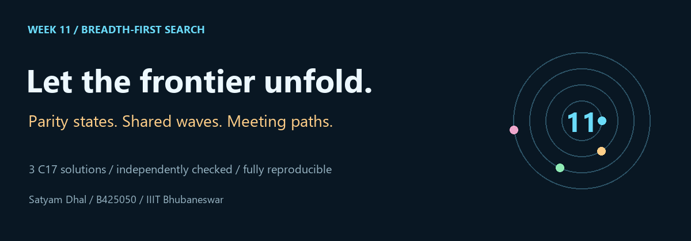
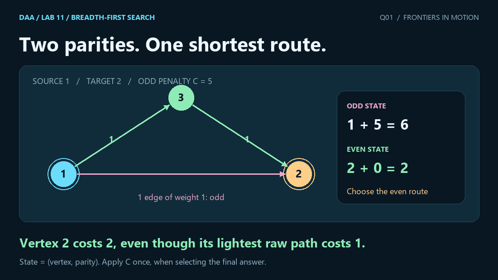

<p align="center"></p>

# Lab 11 · Breadth-First Search

<p align="center"><strong>27 October 2026 · Satyam Dhal · B425050 · IIIT Bhubaneswar</strong><br>Instructor: Dr. Ajaya Kumar Dash</p>

[← Lab 10](../lab10/README.md) · [Repository dashboard](../README.md) · [Problem sheet](Problem-Sheet-Lab-11.pdf) · [Input guide](INPUTS.md) · [Verification](VERIFICATION.md)

Three problems show how a BFS state, seed order or second frontier changes what the search can answer. All solutions are C17 programs with ordinary human-readable stdout. Their explanations, proofs, sample outputs, measured data and GIFs render directly inside GitHub READMEs.

| Question | Exact paper title | Main bound |
|---|---|---|
| **[Q1](Q-1/README.md)** | Shortest Path on Parity-Constrained Graphs via 0-1 BFS | O(V+E) time and space |
| **[Q2](Q-2/README.md)** | Multi-Source BFS for Radius-Constrained Voronoi Cell Partitioning | O(V+E) time and space |
| **[Q3](Q-3/README.md)** | Bidirectional BFS for Shortest Transformation Sequence in a Word Graph | O(NL) expected time; O(N+L) space |

<p align="center"></p>

## The three invariants

1. **Preserve the missing bit.** Q1 searches even and odd parity states separately, then applies the penalty once.
2. **Let the first valid claim win.** Q2 seeds hubs by their input index, so FIFO layers resolve equal-distance claims deterministically.
3. **Meet after complete layers.** Q3 generates exact one-letter neighbours and joins two shortest parent chains.

## Build and reproduce

```sh
python lab11/tools/build.py
python lab11/tools/validate.py
python lab11/tools/generate_evidence.py
# Optional: install Pillow and matplotlib, then regenerate the artwork.
python -m pip install -r lab11/tools/requirements-art.txt
python lab11/tools/generate_visuals.py
```

Run these commands from the repository root. Use `python3` on systems where that is the Python command. GCC or Clang must be on PATH; the `CC` environment variable can override the compiler. On Windows, `lab11/build_windows.bat` performs the strict build and tests. `make -C lab11 visuals PYTHON=python` reproduces all evidence and artwork.

## Validation and measurement

**807 checked executions** comprise 783 core runs and 24 scaling runs. Q1 uses independent Bellman-Ford on explicit parity states; Q2 uses separate BFS from every hub; Q3 uses a straightforward explicit word-graph BFS on small cases and closed-form Hamming-distance checks on complete cubes and a 100000-word limit case. Invalid inputs must fail with a nonzero exit code.

Graphs use two linear axes and count documented operations from real C executions. The C programs do not emit JSON; Python stores stdout and parsed results as reproducibility records. Data is measured, whereas correctness and asymptotic claims are established separately in each question's proof. Q3's hash table provides an expected, rather than adversarial worst-case, constant lookup bound.

## Folder map

```text
lab11/
  Problem-Sheet-Lab-11.pdf
  README.md, INPUTS.md, VERIFICATION.md
  Makefile, build_windows.bat
  common/lab11_common.h
  tools/                      build, independent checks, measurement, art
  assets/                     banner and three-question animation
  Q-1/, Q-2/, Q-3/             C, README, sample, data, graph, animation
```

Prebuilt visual files display on GitHub without running a server or opening a separate app. Rebuild executables locally; generated binaries are excluded from this package.

## Run in VS Code on Windows

Open the package folder, repository root, or `lab11` folder in VS Code, then open a question's `.c` source. Build and debug configurations are supplied at all three levels.
Press **Ctrl+Shift+B** to build, or **F5** and choose **Lab 11: build and debug active C file** to build and run with the debugger. Enter the contents of that question's `qN_sample_input.txt` in the integrated terminal, or provide your own valid input. These stdin programs wait until their required input is supplied.

The included `.vscode` configuration uses `C:/msys64/ucrt64/bin/gcc.exe` with `-x c -std=c17`, and GDB from the same directory. Adjust these paths if your compiler is installed elsewhere. Choose the GCC C task when using the C/C++ Run dropdown. `g++` compiles as C++, whose conversion rules differ from C; adding casts or `-fpermissive` is unnecessary for these C17 sources.
